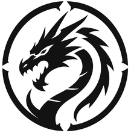

  

  <picture>
    <source media="(prefers-color-scheme: dark)" srcset="images/fatality-icon-white.png">
    
  </picture>

<h3 align="center">PlayStation 2 reverse engineering, modding and online revival</h3>

Fatality Development builds tools for taking PS2 games apart and putting them back together. That covers debuggers and emulators, asset editors, cheat archives, and the servers that bring SOCOM U.S. Navy SEALs II back online on real hardware.

## Projects

| Project | What it is |
|---|---|
| [**CodeDesignerPS2**](https://github.com/FatalityDevelopment/CodeDesignerPS2) | PlayStation 2 debugger and toolkit for VS Code. It has a disassembler, a PCSX2 debugger, the CDS patch language, cheat tools, memory scanners, SOCOM II asset editors, packet capture and an MCP server for AI assistants. |
| [**pcsx2**](https://github.com/FatalityDevelopment/pcsx2) | A PCSX2 fork whose PINE socket adds debugger, controller, network, picture and sound interfaces for CodeDesigner. |
| [**Socom2Multiplayer**](https://github.com/FatalityDevelopment/Socom2Multiplayer) | A private SOCOM II online server in one container: DNS, patch download, DNAS, NAT, MUIS, MAS, MLS lobby and DME game worlds. It is verified on real consoles. |
| [**DnaSDK**](https://github.com/FatalityDevelopment/DnaSDK) | A reverse-engineered DNAS "development kit" that brings DNAS authentication back for unmodified retail discs. |
| [**SocomMapBuilder**](https://github.com/FatalityDevelopment/SocomMapBuilder) | Map, model, texture and animation editors for SOCOM. It can import SOCOM 3 / Combined Assault and GTA: San Andreas models. |
| [**CheatCodeArchive**](https://github.com/FatalityDevelopment/CheatCodeArchive) | An archive of PS2 cheat codes used by CodeDesigner. |
| [**PX86-NintendoDS**](https://github.com/FatalityDevelopment/PX86-NintendoDS) | A Nintendo DS emulator. |

## Members

| | |
|---|---|
|  | [**TylerDev888**](https://github.com/TylerDev888) |
|  | [**mbacker80**](https://github.com/mbacker80) |
